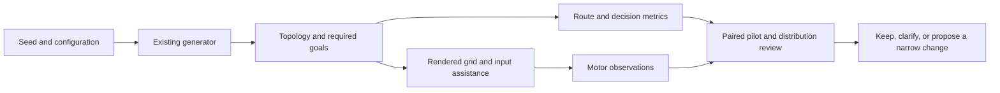

# Maze Press: calibrate puzzle difficulty separately from input effort

- origin: repo-reading-brief
- Source edition: [2026-11-15 Repo Reading Brief](https://chatgpt.com/space/page_b44b1d6dc8e08191a7ee86d0e8a687c1)
- Primary topic ID: `maze-press.motor-versus-decision-difficulty.v1`
- Related topic ID: `maze-press.generator-texture-range.v1`
- Status: research proposal only; no implementation authorized by this document
- Inspected baseline: `fa1068d006f14f509637c546d93d3a8401c06de1`
- Evidence checked: 2026-11-15

## Decision this research should enable

Should Maze Press retain its current path-length difficulty tiers, clarify their scope, or add a second independently calibrated dimension for decision complexity? First establish whether the current settings produce meaningfully distinct puzzles. Do not replace the generator merely because another algorithm is interesting.

This is not a bug report. The interface honestly says harder puzzles favor longer routes. The open question is whether longer routes predict the experience players want, especially when the same puzzle is played with a finger, keyboard, mouse, or printed pencil.

## Current implementation: verified facts

[Source at the inspected commit](https://github.com/byronwall/wall-portfolio/blob/fa1068d006f14f509637c546d93d3a8401c06de1/public/games/maze-press/play.html). Functions below are more useful anchors than line numbers in this compact, largely single-file implementation.

| Area | What the source does | Research implication, not a demonstrated defect |
| --- | --- | --- |
| `carve()` | Depth-first stack traversal with straight/turn bias; a later pass can link dead ends to neighbors. | The result is not always a perfect tree. Study loops and alternate paths as well as branches. |
| `generate()` | Makes nine candidates, sorts by start-to-end shortest-path length, and selects index 0, 4, or 8 for Easy, Standard, Hard. | Labels are relative to nine candidates for that configuration, not global calibrated bands. |
| Quest | Chooses chest locations after candidate selection and builds an ordered route through them. | Analyze total required quest route, not just the earlier start-to-finish path. |
| Wind | Adds directed gates; legal movement checks direction. | Undirected topology alone does not describe the playable decision space. |
| Pattern | Excludes masked cells from the grid. | Normalize metrics by reachable/playable cells rather than rectangle area alone. |
| `strokeTo()` | Looks along legal corridors, at most five cells, without consulting the solution; stops at physical forks and goals. | Motor demands depend on this assistance, not only geometric corridor width. |
| Play state | Guided feedback can warn when a move increases remaining distance; solo removes assistance. Saved attempts are keyed by puzzle code. | Keep assistance fixed in comparisons. Replay and save compatibility are constraints. |
| Replay | Configuration plus seeded generation produces a shareable puzzle code. | Changing random consumption or generation changes what existing codes mean unless explicitly versioned. |

The game entry is dated November 14, 2026. This proposal is tied to that substantive implementation, not an earlier generated research artifact.

## Three readings and their distinct contributions

### Generator texture, not just route length

[Jamis Buck, *Maze Generation: Growing Tree algorithm*, January 27, 2011](https://weblog.jamisbuck.org/2011/1/27/maze-generation-growing-tree-algorithm) provides an animated explanation and sample implementation. An active-cell selection policy changes the character of output: newest-cell selection reproduces recursive backtracking, random selection resembles Prim's, and mixtures interpolate between them.

For this repository, use that as a controlled alternative in an offline comparison only if baseline measurements reveal missing variety. It is not evidence that Growing Tree is better for this game or that current controls are inadequate. A new selection policy also consumes random numbers differently, so preserving seeded replay takes deliberate design.

### Measure the distribution, not a hand-picked gallery

[Gillian Smith and Jim Whitehead, *Analyzing the Expressive Range of a Level Generator*, PCGames, June 18, 2010](https://www.pcgworkshop.com/archive/smith2010analyzing.pdf) evaluates generated levels through chosen metrics and distribution visualizations. Their Launchpad platformer case shows why output count and attractive examples can hide a generator's biases or gaps.

Apply the method, not its platformer metrics: compare many seeded outputs, inspect overlap between difficulty bands, and retain representative examples including failures. Metric choice still embeds judgment. A distribution of branch counts does not prove enjoyment, challenge, or accessibility.

### Separate steering from choosing a route

[Johnny Accot and Shumin Zhai, *Beyond Fitts' Law: Models for Trajectory-Based HCI Tasks*, CHI 1997, March 22–27, 1997](https://chi1997.acm.org/proceedings/paper/ja.html) studies trajectory-constrained movement using steering tasks. Path length and available width matter to motor time in ways not captured by ordinary target-pointing models.

The useful distinction here is between navigating physically and deciding where to go. Do not transplant the paper's fitted constants into a phone game: its apparatus and tasks are different, and Maze Press assists corridor traversal. Treat length/width as a hypothesis-generating descriptor, not a validated Maze Press difficulty equation.

## Proposed investigation

### 1. Freeze a reproducible baseline

Before experiments, capture the commit, configuration, seed/code, graph, ordered goals, gates and solution route for a fixed corpus. Include classic, pattern, quest and wind; minimum/default/maximum grid sizes; low/high turn and dead-end settings. Start with 200 seeds per selected configuration, then expand only if distributions remain unstable. Use held-out seeds for any proposed ranking rule.

Do not add a production telemetry service or alter gameplay as part of research. A future diagnostic harness should run separately and avoid modifying the application bundle. Pin any copied logic to its source SHA and test parity against actual game outputs; otherwise the harness could accidentally evaluate a different generator.

### 2. Separate three measurement families

| Family | Candidate observations | Caveat |
| --- | --- | --- |
| Route burden | Legal shortest route length; quest's required ordered route; route length / playable cells | Length is not decision difficulty; goals and directed edges matter. |
| Decision structure | Legal alternatives at route decisions, distance between decisions, dead-end depths, cycle count, route bends | Correlated metrics must not be blindly summed into a magical difficulty score. |
| Input burden | Actual rendered cell/corridor dimensions, pointer travel, number of separately initiated strokes, wall/gate rejections, assistance mode | Viewport width alone is insufficient. Browser zoom, layout and input modality affect the task. |

Define a route-decision metric with backtracking excluded and gate direction respected. Separately count physical forks because `strokeTo()` intentionally uses physical topology to decide when not to carry the pencil onward. This difference is especially important in wind mode.

Plot route length against route decisions, colored by current tier and faceted by mode and grid size. Add distributions of bends and dead-end depth rather than a single average. Identify pairs with similar length but different decision structure, and pairs with similar structure but different displayed scale. Include random samples, medians and outliers in the gallery; never select only flattering examples.

### 3. Small validation experiment

First, use synthetic pointer and keyboard cases to establish movement invariants: assistance never crosses a physical fork unexpectedly, never uses the solution, never crosses a gate backward, and stops at goals. Test fast drags, contact loss, backtracking and ambiguous target cells. These are proposed tests, not claims that they currently fail.

Then consider a small, separately approved usability pilot with consenting adults. Use matched puzzle pairs, counterbalanced order and held-out seeds; separate input methods and fix guided/solo state. Record completion time, deliberate wrong turns, accidental wall hits, restarts, and a short perceived-challenge rating. Avoid interpreting all extra time as cognitive challenge. Do not collect child data or add analytics to the live game for this pilot.

The exploratory sample will reveal gross mismatches and usability hypotheses, not establish a universal population-level difficulty scale. If physical errors dominate on smaller cells, changing generation is probably the wrong intervention. If tiers overlap heavily in judgments despite low input error, investigate decision topology or clearer labels.

## Conceptual model

This diagram describes the investigation, not a new architecture already implemented.

## Compatibility and stopping rules

- Existing puzzle codes and local saved attempts must remain meaningful. A future generator change needs a versioned replay strategy or retained legacy path; do not silently reinterpret old codes.
- Any candidate must retain reachability of required goals under legal directed movement and correct printed solutions.
- Compare modes separately before considering a shared label. Quest and wind impose obligations absent from classic.
- Prefer keeping the current simple implementation if a sample confirms the intended longer-route behavior and no practical mismatch matters.
- Do not promote a new generator if it merely moves a metric while reducing variety, legibility, replay stability or the game's approachable feel.
- This research does not authorize implementation, a new tracking system, a deployment or an experiment on visitors.

## Agent handoff and review checklist

A later research agent should return:

1. Baseline replay fixtures and a documented, reproducible sampling protocol.
2. A CSV with commit, code, mode, dimensions, control settings, tier, legal route length, playable-cell count, decision count, bends, cycles and explicit metric definitions. Add input-study observations in a separate consented dataset, not in the synthetic corpus.
3. Distribution charts, a seed-linked representative gallery, and an explanation of metric redundancy and missing information.
4. A small test matrix for `strokeTo()`, gates, goals and contact loss, with actual outcomes clearly separated from planned cases.
5. A decision memo: keep current behavior, clarify labels, or propose the smallest change. Include replay compatibility and measurement cost.
6. If a change is warranted, a separate implementation proposal with acceptance criteria and a held-out evaluation plan.

Reviewer questions: Are we solving a player problem rather than optimizing a proxy? Can every figure be reproduced from a seed? Does the interpretation survive separating motor errors from choices? Is the smallest useful answer simply better explanation of current tiers?

## Provenance and verification of this proposal

Deduplication checked all eight existing repository PRs (open/closed/merged search), current documentation tree, and Reading Room coverage history. No earlier Maze Press calibration promotion was found. The unrelated previously covered Uber Maze path-analytics topic is not this game's generator research.

This PR adds documentation only. Source inspection and primary-source reading support the observations above; no live browser measurement, usability trial, benchmark, runtime test or production build was performed. No application change or observed performance improvement is claimed.
